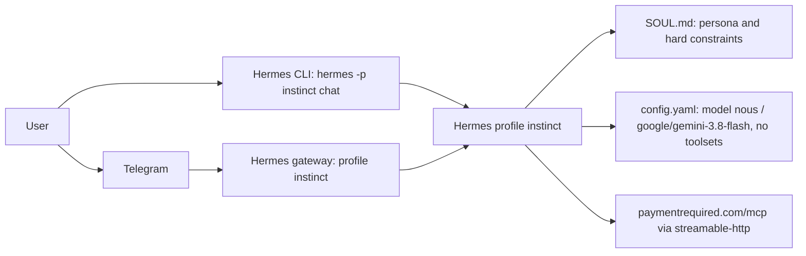
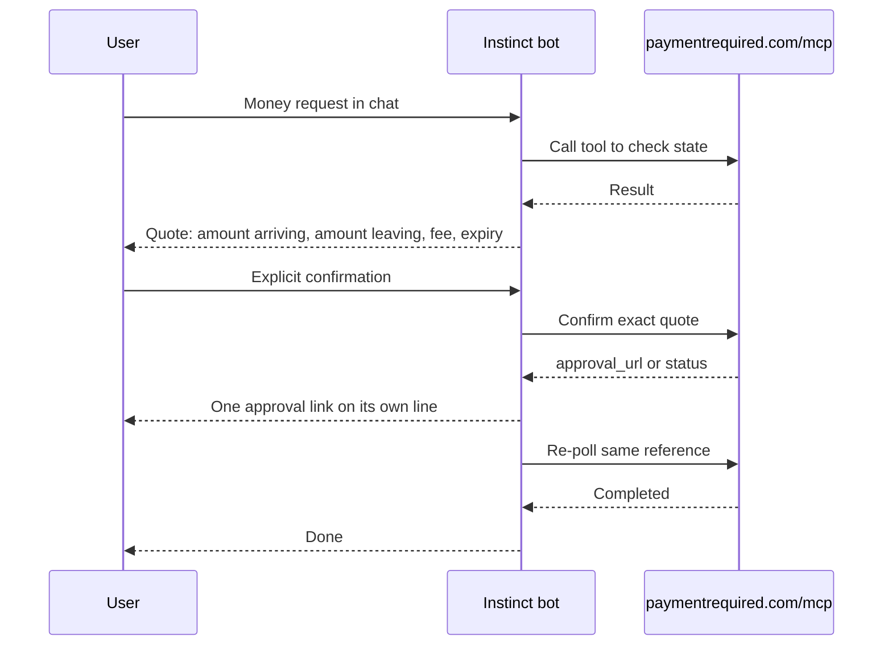

# instinct-bot

Specialist Hermes bot profile running the **Instinct** money assistant.
It answers in plain-text short bubbles, takes direct actions, avoids jargon, and uses `paymentrequired.com/mcp` as its only tool server.
For operators who want to run the Instinct persona in Hermes CLI or on Telegram.

## Logs

- [CHANGELOG.md](CHANGELOG.md)
- [PROMPTLOG.md](PROMPTLOG.md)

## Status

| Field | Value |
|---|---|
| Version | v0.1.0 (`distribution.yaml`) |
| Date | 2026-10-14 |
| Updated by | hermes-agent for emino |
| Default branch HEAD | `96b4910` (main) |
| Deployment | not documented in repo |
| Requires | Hermes `>=0.21.0` (`distribution.yaml`) |

This repo contains configuration only (YAML, JSON, Markdown). There is no application code.

## Architecture



## User flow

Derived from the rules in `SOUL.md`. Actual tool names live on the MCP server and are not listed in this repo.



## Components

| Component | Path | Role |
|---|---|---|
| Persona | `SOUL.md` | Identity, job, hard constraints, Instinct voice rules |
| Runtime config | `config.yaml` | Model `google/gemini-3.8-flash` on provider `nous`, low reasoning effort, MCP server `paymentrequired`, empty toolsets for CLI and Telegram |
| Profile metadata | `profile.yaml` | Profile description and `hermes-bots` UI title |
| MCP manifest | `mcp.json` | `paymentrequired` server, `streamable-http`, `https://paymentrequired.com/mcp` |
| Distribution manifest | `distribution.yaml` | Name `instinct`, version `0.1.0`, Hermes requirement, author, license MIT |
| Ignore rules | `.gitignore` | Keeps `.env`, `auth.json`, DBs, logs, sessions and runtime dirs out of git |

## Run

Install into Hermes:

```bash
hermes profile create instinct --no-skills --no-alias --description "Instinct money assistant. paymentrequired.com/mcp only."
cp SOUL.md ~/.hermes/profiles/instinct/
cp config.yaml ~/.hermes/profiles/instinct/
cp profile.yaml ~/.hermes/profiles/instinct/
cp mcp.json ~/.hermes/profiles/instinct/
```

Run in CLI:

```bash
hermes -p instinct chat
```

Connect to Telegram:

```bash
hermes -p instinct gateway setup
hermes -p instinct gateway start
```

Env var names (set in `~/.hermes/profiles/instinct/.env`, values never in git):

| Name | Purpose |
|---|---|
| `TELEGRAM_BOT_TOKEN` | Telegram bot token for the gateway |
| `TELEGRAM_ALLOWED_USERS` | Telegram users allowed to talk to the bot |

No tests exist in this repo.
